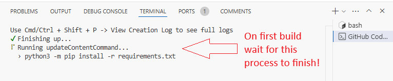
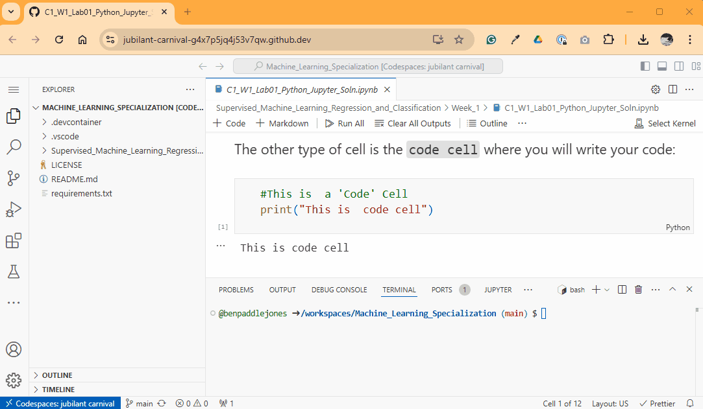

# 2026 Data Hack (High School) Template

A beginner-friendly starter kit for the 2026 netball data hack. It contains four Jupyter notebooks that introduce charts, predictive power and machine learning, using 2026 Suncorp Super Netball player statistics.

No previous machine learning experience is needed. The notebooks show you how to use **NSW EduChat** to help write your code.

## Notebooks

Work through them in this order:

| #   | Notebook                                                           | What you'll learn                                                                                 | Data                         |
| --- | ------------------------------------------------------------------ | ------------------------------------------------------------------------------------------------- | ---------------------------- |
| 1   | [1_Matplotlib_Basics.ipynb](1_Matplotlib_Basics.ipynb)             | How to make bar, scatter, histogram, pie and line charts                                          | Real netball data            |
| 2   | [2_Predictive_Power_Basics.ipynb](2_Predictive_Power_Basics.ipynb) | Which stats help predict others: scatter plots, correlation, R² and common traps                  | Made-up data, then real data |
| 3   | [3_ML_Team_Decision_Demo.ipynb](3_ML_Team_Decision_Demo.ipynb)     | Linear regression, logistic regression and a neural network, used to help a coach make a decision | Made-up data                 |
| 4   | [4_ML_Intro_and_AI_Prompts.ipynb](4_ML_Intro_and_AI_Prompts.ipynb) | Applying the three models to real data, with ready-made EduChat prompts                           | Real netball data            |

Every notebook has runnable code cells, ✏️ **Try it** challenges, and empty cells where you can paste your own code.

## The data

`SSN_2026_Player_Stats_Final.csv` has season totals for 103 players (Rounds 1–12), with one row per player.

| Group       | Columns                                                                     |
| ----------- | --------------------------------------------------------------------------- |
| Player info | `position`, `team`, `first_name`, `surname`, `games`, `quarters`, `minutes` |
| Shooting    | `goals`, `attempts`, `acc_pct`, `one_pt_goals`, `super_shot_goals`          |
| Attack      | `goal_assists`, `feeds`                                                     |
| Defence     | `intercepts`, `deflections`, `gains`, `rebounds`                            |
| Penalties   | `penalties`                                                                 |

> Put the CSV file in the same folder as the notebooks before you start.

## Getting Started

### 1. Open the project

Open this repository in **GitHub Codespaces** or in **VS Code with Dev Containers**. The Python tools install automatically when the container is created.

### 2. Allow the requirements to install

If you're asked, allow `requirements.txt` to install.

### 3. Select the Python environment

Open a notebook, click **Select Kernel** (top right) and choose the Python environment.

### 4. Run the cells

Click a code cell and press **Shift + Enter**. Run the cells **in order, from top to bottom**.

### Libraries used

`pandas`, `numpy`, `matplotlib`, `scikit-learn`, and `tensorflow` / `keras` (optional, for the advanced neural network prompts).

## Using NSW EduChat

EduChat is designed as a tutor, so it may ask you questions instead of giving you code straight away. The notebooks show you how to:

1. **Start each chat** with a short message that describes your data
2. **Write short, clear prompts** that begin with _"Write complete ... code, with comments"_
3. **Reply to its questions**: have a go, show your attempt, or ask for the complete code and explain it back

## Help

| Problem                               | Fix                                                                      |
| ------------------------------------- | ------------------------------------------------------------------------ |
| `FileNotFoundError` for the CSV       | Put `SSN_2026_Player_Stats_Final.csv` in the same folder as the notebook |
| `NameError: name 'df' is not defined` | Run the cells above first, especially the one that loads the data        |
| `KeyError` for a column               | Column names are lowercase with underscores, e.g. `goals`, `acc_pct`     |
| Nothing happens when you run a cell   | Check a kernel is selected (top right of the notebook)                   |
| A chart doesn't appear                | Make sure the code ends with `plt.show()`                                |

## Authors

[@benpaddlejones](https://github.com/benpaddlejones)

## License

This project is licensed under the GNU General Public License v3.0. See the [LICENSE](LICENSE) file for details.

## Acknowledgments

- [Github md syntax](https://docs.github.com/en/get-started/writing-on-github/getting-started-with-writing-and-formatting-on-github/basic-writing-and-formatting-syntax)
- [TempeHS Jupyter-Notebook template](https://github.com/TempeHS/TempeHS_Jupyter-Notebook_DevContainer)
